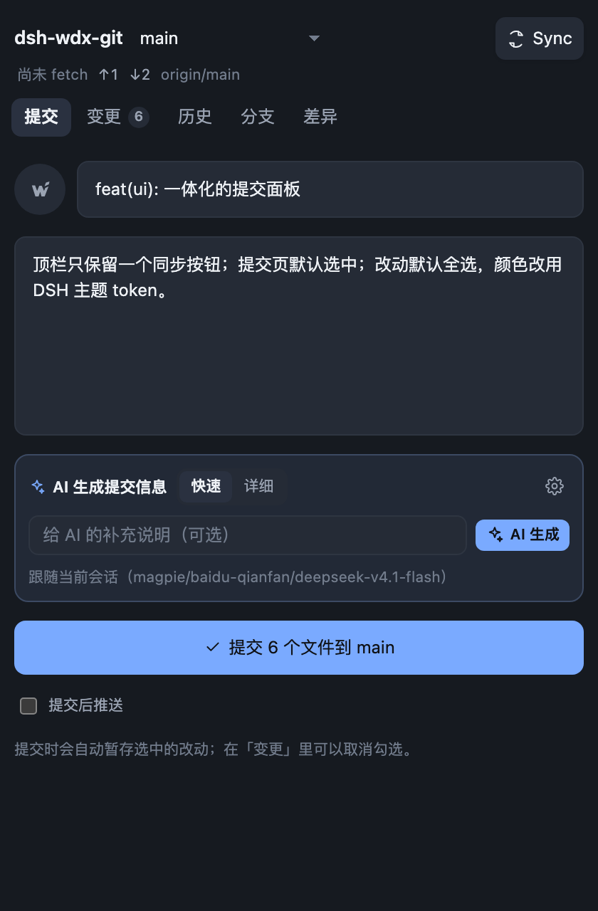
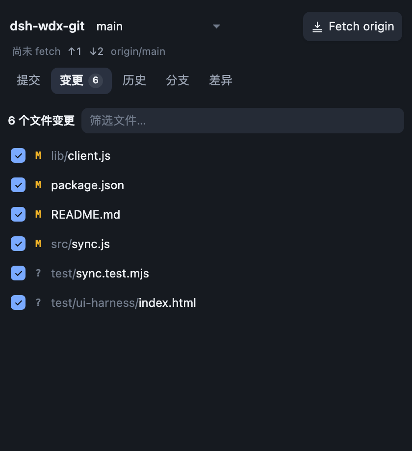
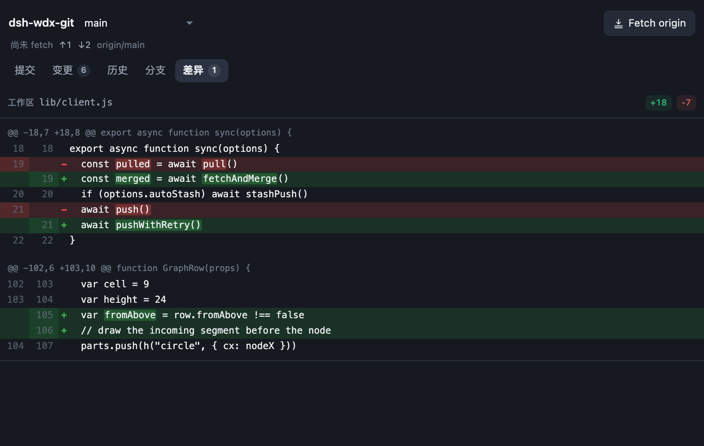
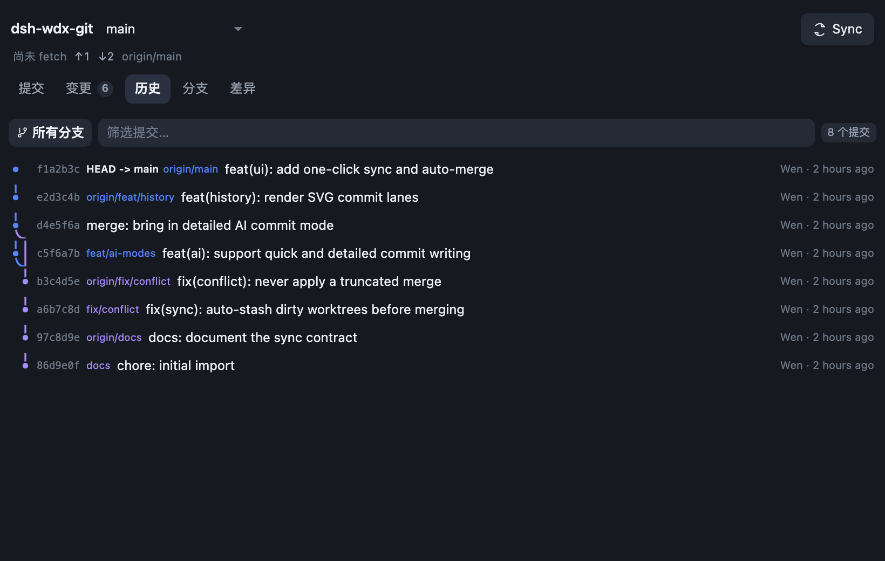
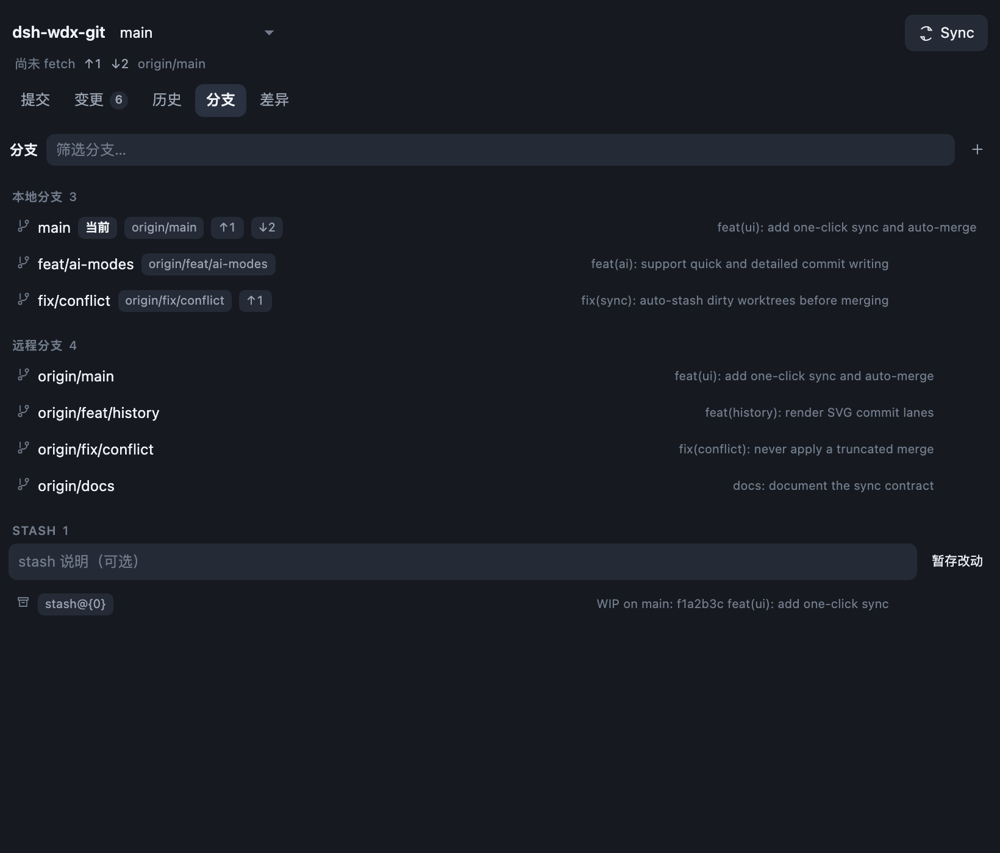
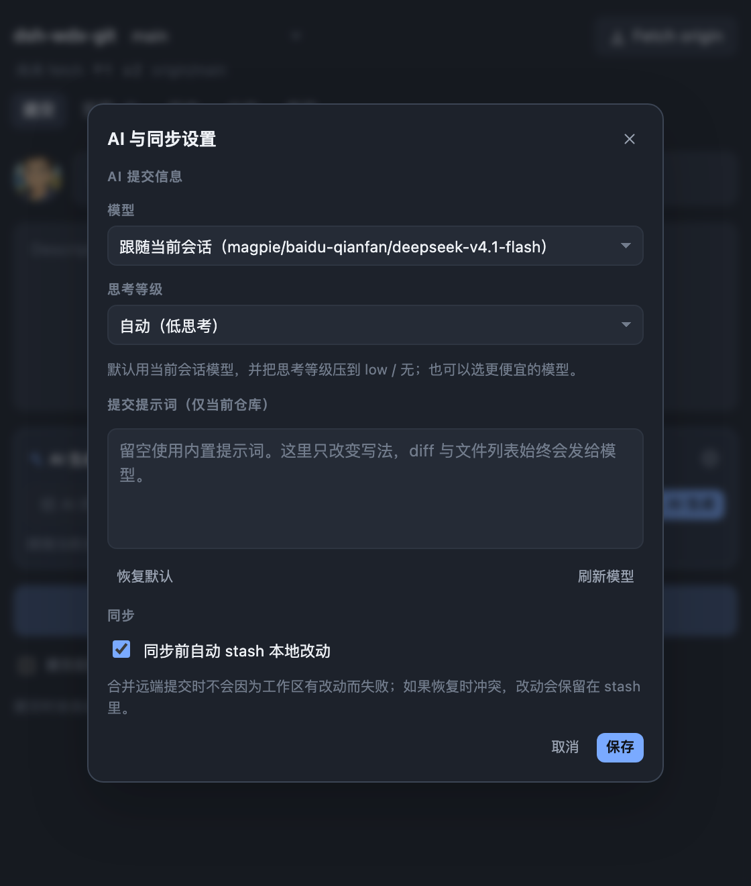
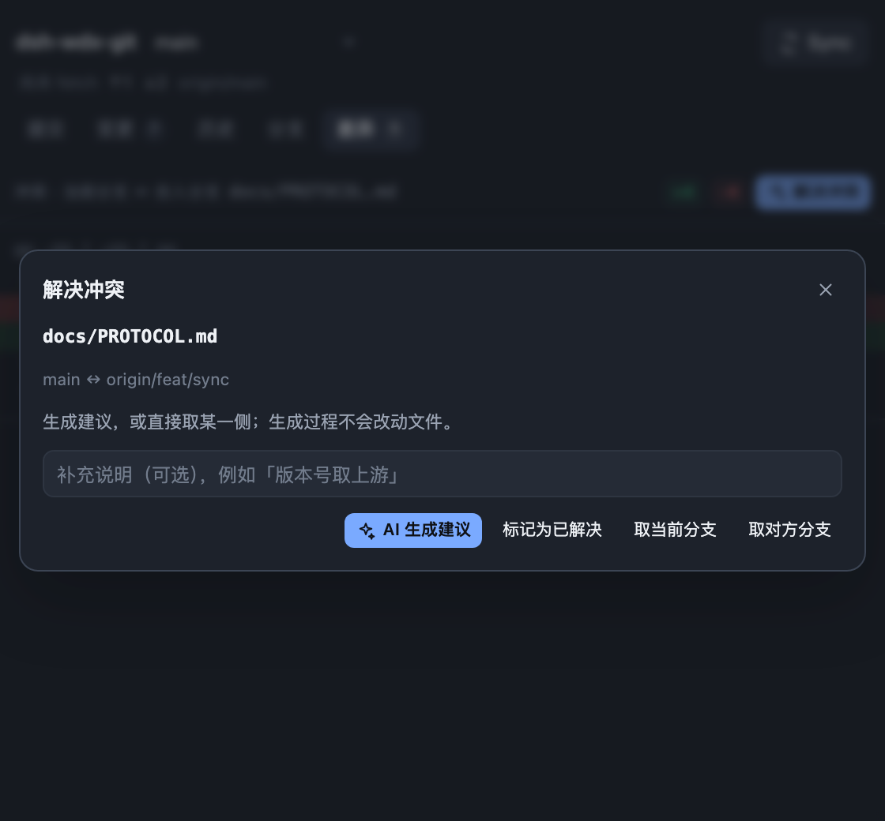
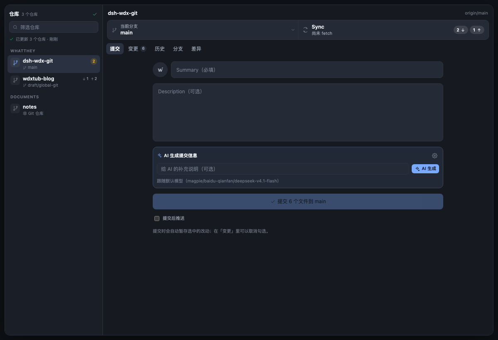

# WDX Git

**Git without leaving your AI session.**

WDX Git is a Git panel for DeepSeek Harness: the right sidebar manages the repository for the current session, and the global page in the left sidebar lists every workspace at once. After AI edits, you don't need to switch to a terminal, or choose between a row of Pull / Push / Fetch buttons: one sync button pulls, merges, and pushes, and it labels itself from the repository state — **Fetch origin / Pull origin / Push origin / Publish branch / Sync**. The Commit tab opens by default with every change checked, and AI can write the commit message for you.

> DSH 0.2.x · macOS / Windows / Linux · MIT



## Why WDX Git

AI made writing code faster, but the Git flow is still the old one:

- After editing, switch to a terminal and remember `pull`, `merge`, `push`;
- Come back and decide which files to stage and how to write the commit message;
- On conflict, switch tools again, and by the time it's resolved you've forgotten what you were doing.

WDX Git keeps that flow next to the session and leaves only the decisions that genuinely need you:

| Common flow | WDX Git |
| --- | --- |
| Fetch first, then decide Pull / Push | The toolbar button shows Fetch / Pull / Push automatically; one click does what's needed |
| Manually check the files to commit | Everything is checked by default; uncheck what you don't want to commit |
| Write the commit message yourself | AI reads this diff and writes it in the repository's style |
| Switch to an external tool on conflict | See ours / theirs in the panel and continue after resolving |

It's not another GitHub Desktop; it brings the smoothest parts of GitHub Desktop into DSH.

## Who it's for

- People who write code and edit docs with AI in DSH and commit often;
- People who don't want to switch to a terminal repeatedly for `pull` / `push` / staging;
- People who want consistent commit messages without writing each one by hand;
- People who like how GitHub Desktop feels but want it next to their AI session.

## Three core experiences

### One button for sync

The toolbar shows only the repository, the branch, and one sync button. The label follows the repository state:

| State | Button |
| --- | --- |
| In sync | Fetch origin |
| Behind the remote only | Pull origin |
| Local commits only | Push origin |
| New commits on both sides | Sync |
| No upstream yet | Publish branch |

When the branch is behind or ahead, the button shows count badges with directional arrows: `↓` for remote commits to pull, `↑` for local commits to push.

Whatever the label, one click lets WDX Git do the work:

```
fetch → set upstream if needed → fast-forward or merge → push when needed
conflict → resolve → continue / restore stash → push
```

Working-tree changes are stashed automatically before a merge and restored afterwards. A rejected push is fetched + merged and retried (up to 4 rounds). On conflict it stops and waits for you; once you've resolved it, it continues and pushes automatically — no need to understand commit / continue / stash. **No force push, no automatic rebase, no rewriting existing history.**

### Commit tab first, changes checked by default

Opening the panel shows the commit form: a generic committer icon and a Summary line, Description on its own line, then the AI area and the commit button. Every change is checked by default; unchecking a file leaves it in the working tree and out of this commit.

Only the checked paths are staged. To commit everything, just write the title and click; to be more selective, uncheck files under "Changes".

### AI writes the commit message, but doesn't decide for you

- One request writes subject + body: the body is written at pull-request-summary density — one sentence of motivation, then 2–4 concrete changes; when tests are involved it says what's covered, with no filler.
- If the format is broken (truncated, a half-sentence subject, missing body), it retries automatically, up to 3 times; if it still fails you get a commit-ready fallback message.
- It follows the current session model by default, with reasoning effort automatically lowered; you can also pick a cheaper model in settings.
- It reads only the diff and files for this commit; unchecked files never appear in the message.

AI only generates content. Staging, committing, pushing, and writing conflict resolutions all happen after you click.

## At a glance

| Changes: checked by default | Diff: word-level highlight |
| --- | --- |
|  |  |

| History: SVG lanes | Branches and stash |
| --- | --- |
|  |  |

| AI and sync settings | Conflict resolution |
| --- | --- |
|  |  |

## Also in there

- **Cross-project repositories page**: the **Git** entry in the left sidebar lists every workspace in the current DSH, grouped by parent folder like GitHub Desktop, with branch, ahead/behind, and change counts; open any repository to commit directly without starting a session in that project first. The overview refreshes every 30 seconds; a manual refresh spins the button, then shows a green check and the result, and changed rows highlight briefly.



- **Integrated UI**: the toolbar, tabs, and content share one background, with no cards or borders; all colors come from DSH theme tokens, adapting automatically to light and dark themes.
- **Changes, history, branches, diff**: per-file views, commit search, all-branches / current-branch switching, and an SVG commit lane graph.
- **Conflicts without forcing**: view ours ↔ theirs, get an AI merge suggestion (preview only; nothing is written until you confirm), or use "Resolve all with AI" to merge and stage files one by one (large files are handled per conflict region); take one side or mark a file resolved by hand. Settings has "Resolve conflicts with AI after sync" (off by default) so a sync conflict is handled immediately. After the last conflict is resolved it automatically commits the merge / continues the rebase, restores the auto-stash, and pushes according to the original Sync / Push intent; abort / continue are still supported.
- **System proxy**: on macOS it reads the system HTTP/HTTPS proxy automatically, so a DSH started from Finder can still fetch / push; it also respects your existing proxy environment variables.
- **Data stays local**: Git operations, history, branches, and stash stay on your machine; the plugin stores no tokens and does no telemetry.
- **No profile avatars**: the left side of the commit form is the wdxtub-blog W mark (a monochrome simplified version, keeping the small top-right flourish); it does not read or show your DSH account avatar or GitHub avatar.

## Install

### From the plugins page

Open **Plugins → Add plugin** in the DSH sidebar and enter the package name:

```
dsh-wdx-git
```

Choose the npm official registry as the install source, then enable it. If the mirror isn't synced yet, switch the install source and try again.

npm package page: <https://www.npmjs.com/package/dsh-wdx-git>

### From source

```bash
git clone https://github.com/wdxtub/dsh-wdx-git.git
dsh plugin --profile desktop add ./dsh-wdx-git
```

Refresh the page after installing. There are three entry points:

1. **Git** in the left sidebar (global repositories page);
2. The **Git branch icon** in the session header toolbar;
3. The right sidebar's **+ → Start → "WDX Git"**.

> After updating Host code (`index.js` / `src/`), reopen DSH so the Host reloads; refreshing the page only updates the client.

## Getting started

1. Open the Git panel for any session; it opens on "Commit" by default.
2. The toolbar shows **Fetch origin / Pull origin / Push origin / Sync**; click to sync with the remote. It merges and pushes automatically when needed.
3. Write a Summary, or click **Generate with AI**.
4. Click "Commit N files to main"; check "Push after commit" to sync next.

## FAQ

**Q: Why does the toolbar button change?**

A: It reflects one thing only: what a click will mainly do. In sync is Fetch origin, behind is Pull origin, local commits is Push origin, both sides is Sync, and no upstream is Publish branch. The button shows the last fetch time and ahead/behind count badges with directional arrows; the repository row shows the upstream. After clicking, the status line tells you whether it fetched, merged, or pushed, and whether it touched the stash.

**Q: Does it ever force push?**

A: No. When the remote has advanced and the push is rejected, it only fetches + merges + retries once; if that fails it shows you git's own error. It never rebases automatically or rewrites history.

**Q: Can AI see my whole repository?**

A: No. It sees the diff for this commit, the file list, recent commit titles, and the selected untracked text files. Requests go to the model provider you chose in settings.

**Q: Does it work with private repositories?**

A: Yes. WDX Git uses your machine's existing git credentials; any repository git can reach on this machine works in the panel.

**Q: How are proxies handled?**

A: On macOS it reads the system proxy automatically; other platforms use `HTTPS_PROXY` / `HTTP_PROXY` / `ALL_PROXY`, or git's own `http.proxy` configuration.

**Q: What about conflicts?**

A: A conflict during sync stops and waits for you; it won't merge before you act. In the panel you can view both sides, take one, click "Resolve all with AI" to merge and stage files one by one (large files are resolved per conflict region), or edit by hand and "Mark as resolved". Once everything is resolved, the plugin automatically creates the merge commit / continues the rebase, restores the auto-stashed local changes, and pushes according to the original action.

**Q: What's the relationship to GitHub Desktop?**

A: The interaction is inspired by GitHub Desktop, but this is a native panel redesigned for DSH sessions: one button, default commit, default-checked changes — it doesn't replace your existing Git workflow.

## What we deliberately don't do

- No force push, no automatic rebase, no rewriting commit history;
- No bypassing hooks, no commit signing;
- No hunk-level / line-level partial staging (down to file level);
- No remote picker UI: with multiple remotes, `origin` is preferred;
- No background commits: the commit / continue after conflict resolution happens only after you've resolved the conflict (or clicked "Resolve with AI").

## Developers

- RPC, data structures, and the Host ↔ Client contract: [PROTOCOL.md](PROTOCOL.md)
- Release history: [CHANGELOG.md](CHANGELOG.md)
- Release process: [RELEASING.md](RELEASING.md)
- Run tests: `npm test` (currently 63 tests)
- Implementation: Host side `index.js` / `src/`, client in the single file `lib/client.js`, no build step.

## License

MIT
