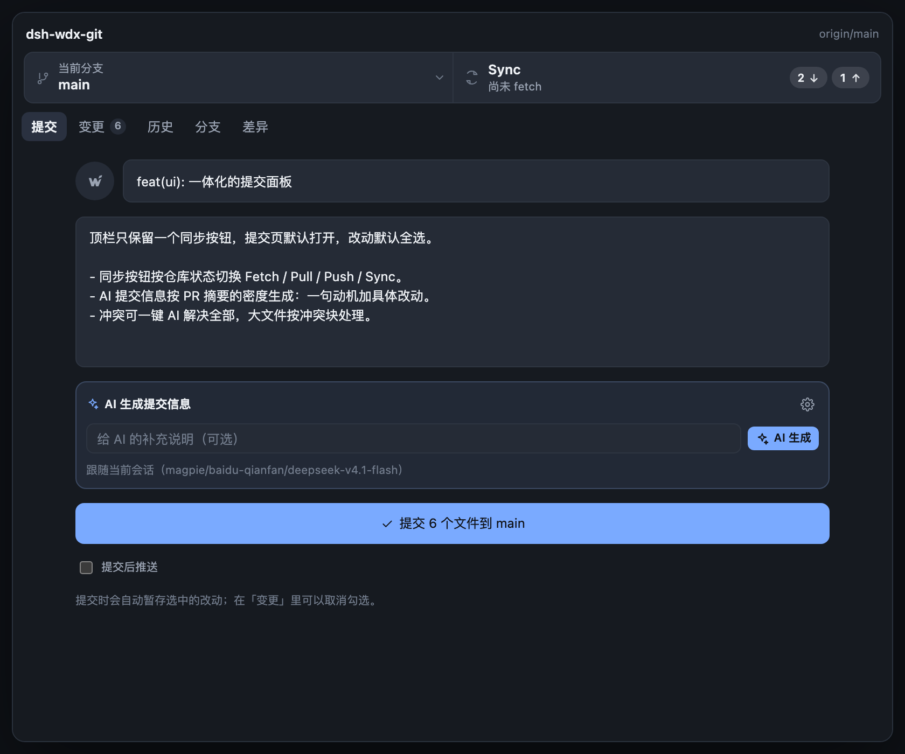
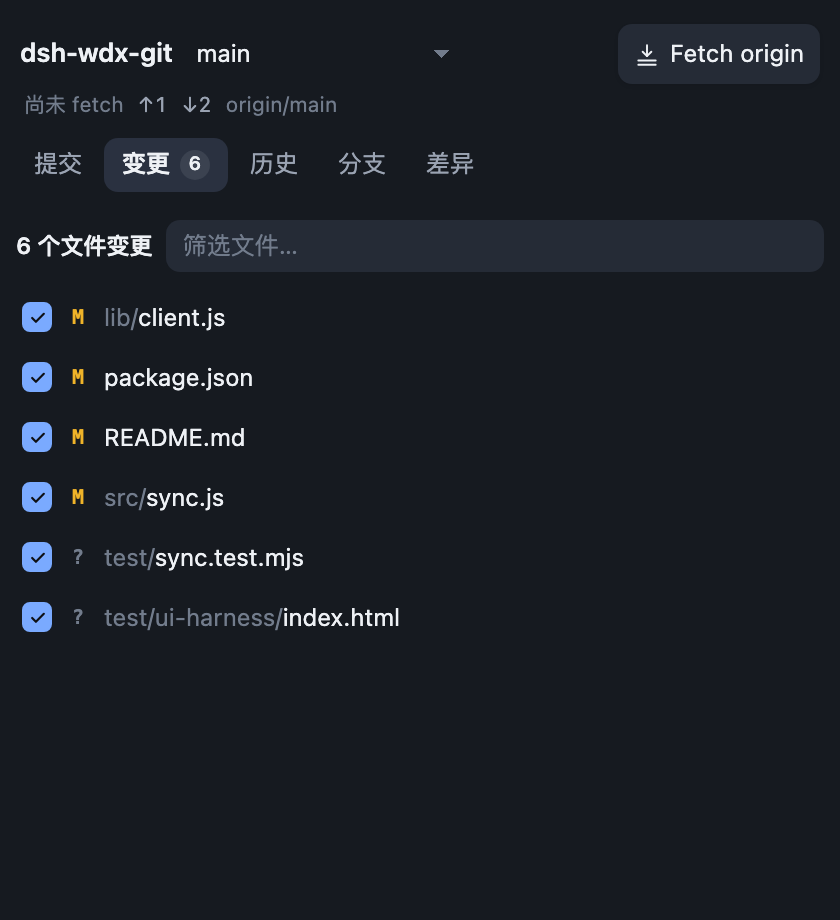
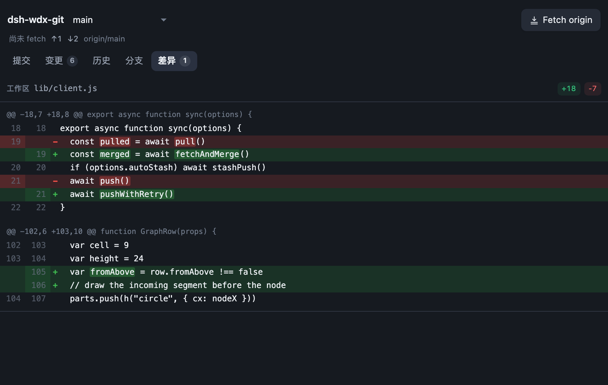
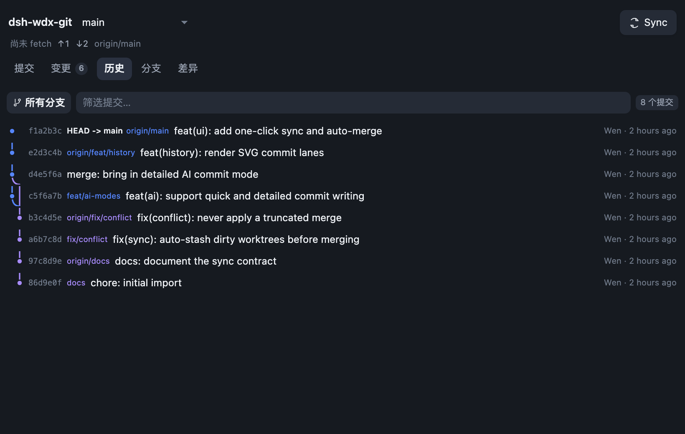
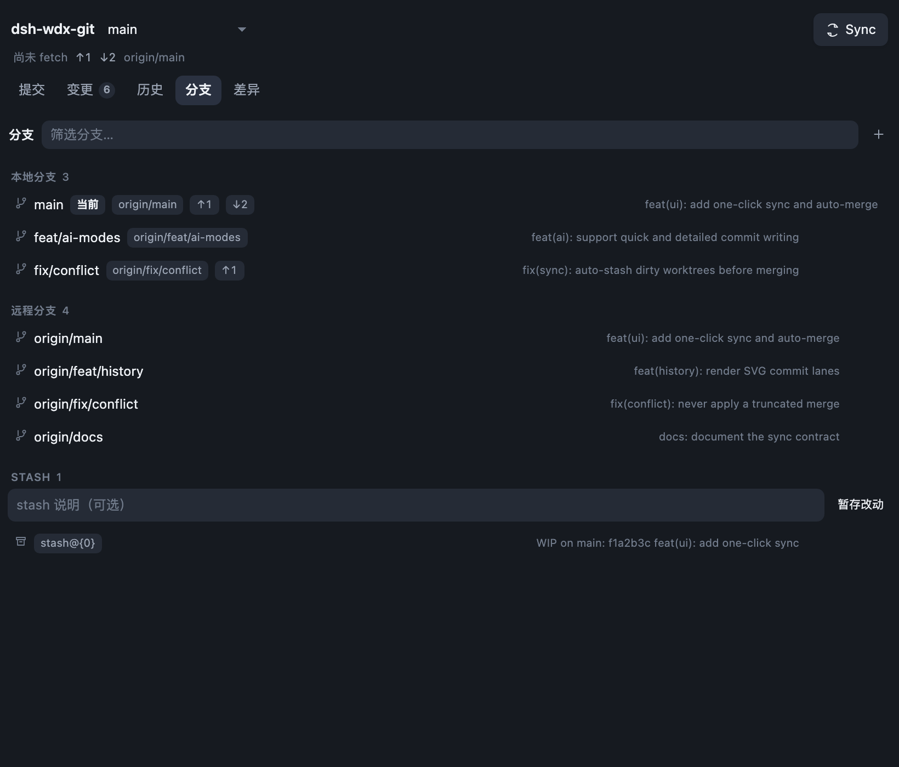
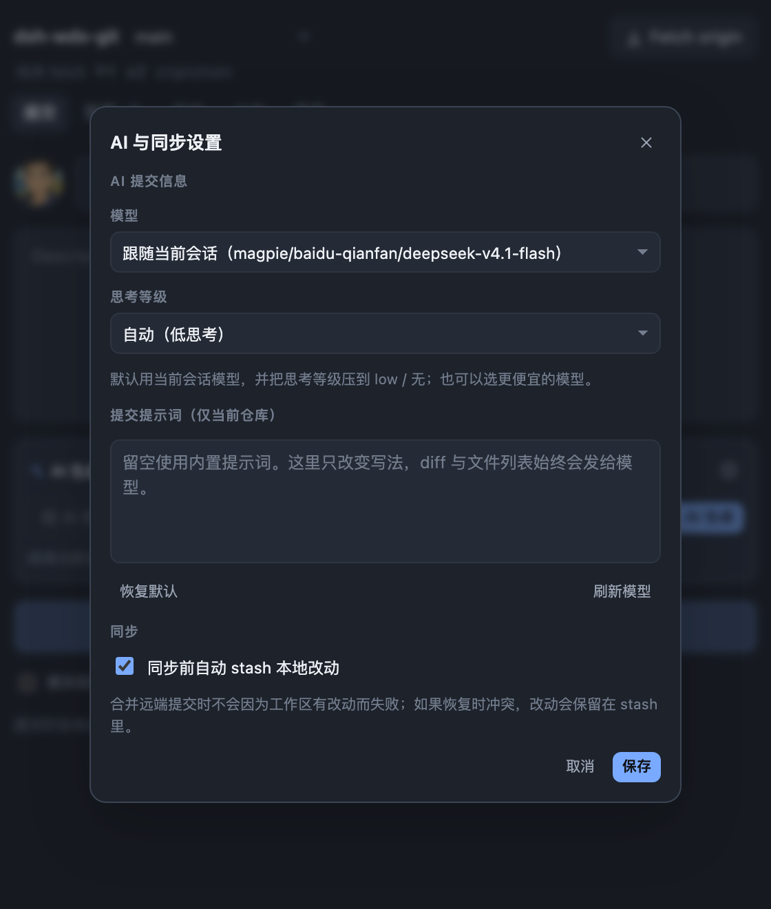
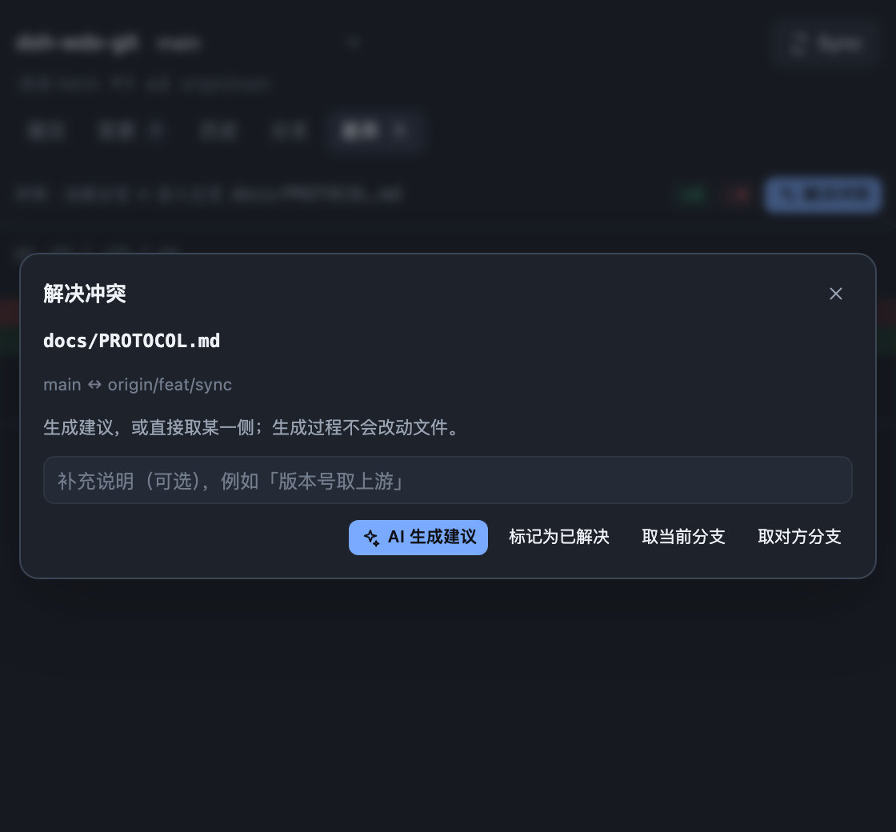

# WDX Git

**Git，不再打断你的 AI 会话。**

WDX Git 是 DeepSeek Harness 右侧栏里的 Git 面板。AI 改完代码，你不需要切到终端，
也不需要在一排 Pull / Push / Fetch 按钮里做选择：一个同步按钮完成拉取、合并和推送，
并会按仓库状态显示 **Fetch origin / Pull origin / Push origin / Publish branch / Sync**；
提交页默认打开，改动默认全选；提交信息可以让 AI 顺手写好。

> DSH 0.2.x · macOS / Windows / Linux · MIT



## 为什么做 WDX Git

AI 让写代码变快了，但 Git 流程还是旧的：

- 改完要切终端，记 `pull`、`merge`、`push`；
- 回来还要想哪些文件该 stage、提交信息怎么写；
- 冲突了再切工具，处理完已经忘了刚才在做什么。

WDX Git 把这段流程留在会话旁边，只保留真正需要你做的决定：

| 常见流程 | WDX Git |
| --- | --- |
| 先 Fetch，再判断 Pull / Push | 顶栏按钮自动显示 Fetch / Pull / Push，点一下完成需要的事 |
| 手动勾选要提交的文件 | 默认全选，不想提交的再取消 |
| 手写提交信息 | AI 读本次 diff，按仓库风格写 |
| 冲突时切到外部工具 | 在面板里看 ours / theirs，解决后继续 |

它不是另一个 GitHub Desktop，而是把 GitHub Desktop 最顺手的部分带进 DSH。

## 适合谁

- 在 DSH 里用 AI 写代码、改文档，提交频率高的人；
- 不想为了 `pull` / `push` / stage 反复切到终端的人；
- 希望提交信息规范、但不想每次都手写的人；
- 喜欢 GitHub Desktop 的顺手，但希望它长在 AI 会话旁边的人。

## 三个核心体验

### 一个按钮，完成同步

顶栏只有仓库、分支和一个同步按钮。按钮会按仓库状态显示：

| 状态 | 按钮 |
| --- | --- |
| 已同步 | Fetch origin |
| 只落后远端 | Pull origin |
| 只有本地提交 | Push origin |
| 两边都有新提交 | Sync |
| 还没有 upstream | Publish branch |

落后或领先远端时，按钮内会出现带方向箭头的计数徽标：`↓` 是待拉取的远端提交，
`↑` 是待推送的本地提交。

不管显示哪一个，点下去都由 WDX Git 完成：

```
fetch → 补 upstream → 快进或合并 → 需要时推送
```

工作区有改动时先自动 stash，合并后恢复；推送被拒时自动重试一次。
冲突才停下来。**不 force push，不自动 rebase，不改写已有历史。**

### 提交页先出现，改动默认全选

打开面板先看到提交表单：通用提交者图标和 Summary 一行，Description 单独一行，
AI 区域和提交按钮依次排开。所有改动默认勾选；取消某个文件，它就只留在工作区，
不会进入这次提交。

提交时只暂存选中的路径。想全部提交，直接写标题、点按钮；想精细一点，
去「变更」里取消勾选即可。

### AI 写提交信息，但不替你做决定

- 一次生成标题 + 正文：正文按 PR 摘要的密度写——一句动机，再 2–4 条具体改动；涉及测试时说明覆盖范围，不写空话；
- 格式不合格（被截断、标题半句、缺正文）会自动重试，最多 3 次；仍不行为你保留可提交的降级文案；
- 默认跟随当前会话模型，思考等级自动压低；也可以在设置里换成更便宜的模型；
- 只读取本次会提交的 diff 和文件；取消勾选的文件不会出现在提交信息里。

AI 只负责生成内容。提交、推送和冲突文件的写入，都在你点下按钮后执行。

## 一眼看懂

| 变更：默认全选 | 差异：词级高亮 |
| --- | --- |
|  |  |

| 历史：SVG 车道图 | 分支与 Stash |
| --- | --- |
|  |  |

| AI 与同步设置 | 冲突解决 |
| --- | --- |
|  |  |

## 还有这些

- **一体化界面**：顶栏、tab、内容共用一层背景，没有卡片和外框；颜色全部来自
  DSH 主题 token，深浅主题自动适配。
- **变更、历史、分支、差异**：逐文件查看、提交搜索、所有分支 / 当前分支切换、
  SVG 提交车道图。
- **冲突不硬来**：可看 ours ↔ theirs，AI 生成合并建议（只预览，确认后才写入）、
  一键「AI 解决全部」逐个文件自动合并并暂存（大文件按冲突块处理），也可取某一侧
  或手工标记已解决；设置里可打开「冲突后自动用 AI 解决」（默认关闭），同步一产生
  冲突就自动处理；支持中止 / 继续 merge / rebase / cherry-pick / revert。
- **系统代理**：macOS 自动读取系统 HTTP/HTTPS 代理，Finder 启动的 DSH 也能正常
  fetch / push；也尊重你已有的代理环境变量。
- **数据留在本地**：Git 操作、历史、分支、stash 都在你本机；插件不保存 token，
  也不做遥测。
- **头像不读个人资料**：提交表单左侧是 wdxtub-blog 的 W 标记（单色简化版，保留右上角小装饰），
  不读取、不展示你的 DSH 账户头像或 GitHub 头像。

## 安装

### 从插件页安装

打开 DSH 侧栏 **插件** → **添加插件**，输入包名：

```
dsh-wdx-git
```

安装源选 npm 官方源，装好后点 **立即启用**。如果镜像还没同步，切换安装源再试一次即可。

npm 包主页：<https://www.npmjs.com/package/dsh-wdx-git>

### 从源码安装

```bash
git clone https://github.com/wdxtub/dsh-wdx-git.git
dsh plugin --profile desktop add ./dsh-wdx-git
```

安装后刷新页面。入口有两个：

1. 会话头部工具栏的 **Git 分支图标**；
2. 右栏的 **+ → 开始** →「WDX Git」。

> 更新了 Host 代码（`index.js` / `src/`）后，重开一次 DSH 让 Host 重新加载；
> 只刷新页面只会更新客户端。

## 上手

1. 打开任意会话的 Git 面板；默认就在「提交」。
2. 顶栏按钮会显示 **Fetch origin / Pull origin / Push origin / Sync**，点一下同步远端；
   需要时它会自动合并、推送。
3. 写 Summary，或者点 **AI 生成**。
4. 点「提交 N 个文件到 main」；勾选「提交后推送」可以接着同步。

## 常见问题

**Q：顶栏按钮为什么会变？**

A：它只反映一件事：点下去主要会发生什么。已同步是 Fetch origin，落后是 Pull origin，
有本地提交是 Push origin，两边都有是 Sync，没有 upstream 是 Publish branch。
按钮内会显示上次 fetch，以及带方向箭头的领先 / 落后计数徽标；仓库行显示 upstream。
点下之后，状态栏会告诉你这次是 fetch、merge 还是 push，以及是否动过 stash。

**Q：会不会自动 force push？**

A：不会。远端前进导致 push 被拒时，只 fetch + merge + 重试一次；再失败就把
git 的错误原样告诉你。也不会自动 rebase 或改写历史。

**Q：AI 会看到我的整个仓库吗？**

A：不会。它看到的是本次待提交的 diff、文件列表、最近提交标题，以及选中的
未跟踪文本文件。请求发送给你在设置里选择的模型服务商。

**Q：私有仓库能用吗？**

A：能。WDX Git 使用你本机已有的 git 凭据；能在这台机器上用 git 访问的仓库，
面板就能用。

**Q：代理怎么处理？**

A：macOS 下自动读取系统代理；其他平台使用 `HTTPS_PROXY` / `HTTP_PROXY` /
`ALL_PROXY`，或 git 自身的 `http.proxy` 配置。

**Q：冲突怎么办？**

A：同步遇到冲突会停下来，不会偷偷提交。你可以在面板里看两边差异、取某一侧，
点「AI 解决全部」让它逐个文件合并并暂存（大文件按冲突块逐个解决），或手工改完后
「标记为已解决」。

**Q：和 GitHub Desktop 是什么关系？**

A：交互灵感来自 GitHub Desktop，但这是为 DSH 会话重新设计的原生面板：
一个按钮、默认提交、默认全选，不替代你现有的 Git 工作流。

## 我们刻意不做

- 不 force push，不自动 rebase，不改写提交历史；
- 不绕过 hooks，不做 commit signing；
- 不做 hunk 级 / 行级 partial staging（选择到文件级）；
- 不做远端选择 UI：多远端时优先 `origin`；
- 不在后台自动提交；冲突也只在你点了「AI 解决」之后才写入。

## 开发者

- RPC、数据结构和 Host ↔ Client 契约：[PROTOCOL.md](PROTOCOL.md)
- 版本记录：[CHANGELOG.md](CHANGELOG.md)
- 发布流程：[RELEASING.md](RELEASING.md)
- 运行测试：`npm test`（当前 45 个测试）
- 实现：Host 侧 `index.js` / `src/`，客户端单文件 `lib/client.js`，无构建步骤。

## License

MIT
