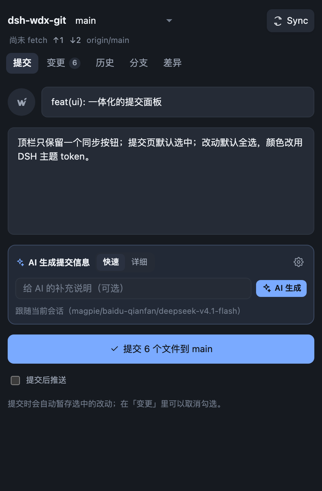
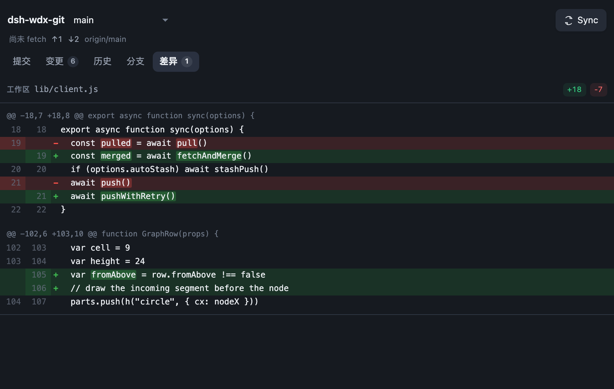
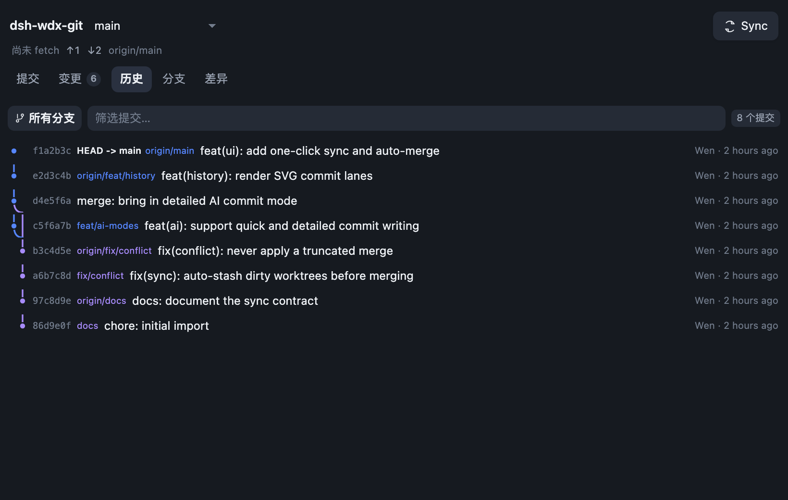
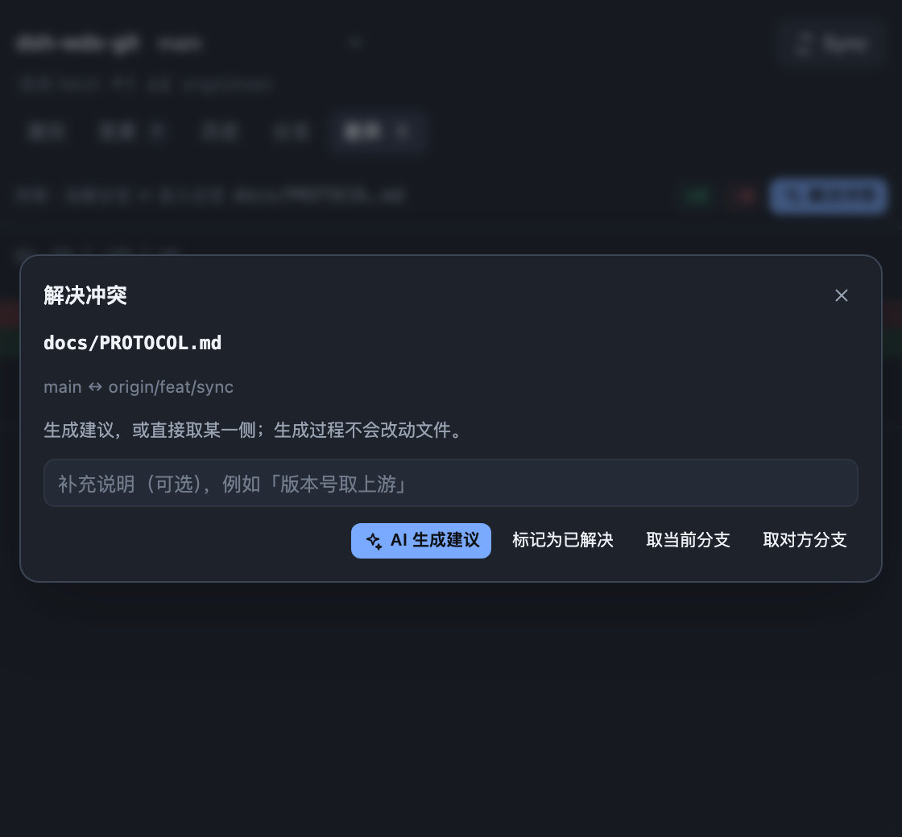

# WDX Git

WDX Git adds a Git panel to the DeepSeek Harness right sidebar. Open it from the
branch icon in the session header, or from **+ → Start → WDX Git** in the right
sidebar. Commit, sync, history, branches, and conflict work stay next to the
session instead of moving to a terminal.

## Sync with one button

The toolbar shows the repository, the current branch, and one sync button. The
button label follows the repository state:

| State | Button |
| --- | --- |
| Nothing to pull or push | Fetch origin |
| Behind the remote | Pull origin |
| Ahead of the remote | Push origin |
| Both sides have new commits | Sync |
| Branch has no upstream | Publish branch |

A click runs fetch, sets the upstream when needed, fast-forwards or merges, then
pushes when there is something to push. Working-tree changes are stashed before a
merge and restored afterwards. A rejected push is retried once after fetch and
merge. A conflict stops the operation. WDX Git never force-pushes, rebases
automatically, or rewrites existing history.

## Commit tab

The panel opens on the Commit tab. Summary and description are separate fields,
and every change is checked by default. Uncheck a file to keep it in the working
tree: only the checked paths are staged and committed.

## AI commit messages

Two modes are available. Quick writes one Conventional Commit line. Detailed adds
the reason, the behavior change, limits, and verification information. The
default model is the one used by the current session; a different model and
reasoning effort can be configured in settings. The request contains the diff and
file list for this commit, plus, in Detailed mode, recent commit titles and the
selected untracked text files; unchecked files do not appear in the message.

## Changes, diff, history, and branches

The Changes tab lists modified, added, and deleted files and opens a word-level
diff for the selected file. History shows commit parents, author, time, and
message, with the commit lanes drawn as an SVG graph. Branches lists local and
remote branches and switches or creates branches. Stash saves and restores work
in progress.

## Conflicts

When a fetch, merge, rebase, cherry-pick, or revert stops on a conflict, the
Conflicts tab shows ours and theirs. Take one side, ask AI for a merge suggestion
(preview only; nothing is written until you confirm), or edit the file and mark
it resolved. Merge, rebase, cherry-pick, and revert can also be continued or
aborted from the panel.

## Local data

Git runs on your machine with your existing credentials, inside the repository
open in the session. The plugin does not store tokens, does not send telemetry,
and does not read your DSH account or GitHub avatar. On macOS it reads the system
HTTP/HTTPS proxy so a DSH started from Finder can still fetch and push; other
platforms use `HTTPS_PROXY`, `HTTP_PROXY`, `ALL_PROXY`, or git's own
`http.proxy`.

## Deliberate limits

- No force push, automatic rebase, or history rewriting.
- No commit signing.
- Staging is per file, not per hunk or line.
- With multiple remotes, `origin` is preferred.
- Nothing is committed in the background.

## Install

In DSH open **Plugins → Add plugin**, enter `dsh-wdx-git`, choose the npm
registry, then enable it. To install from a checkout, run
`dsh plugin --profile <name> add ./dsh-wdx-git`.