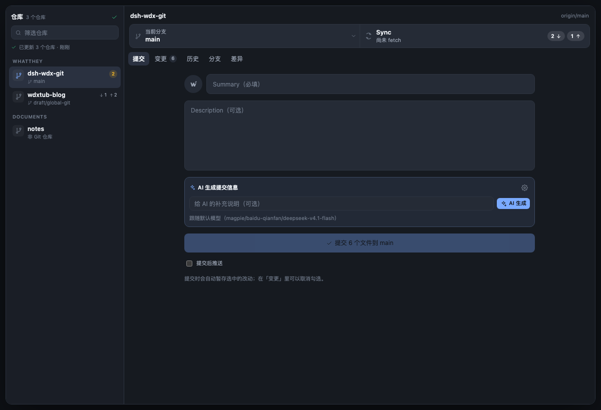
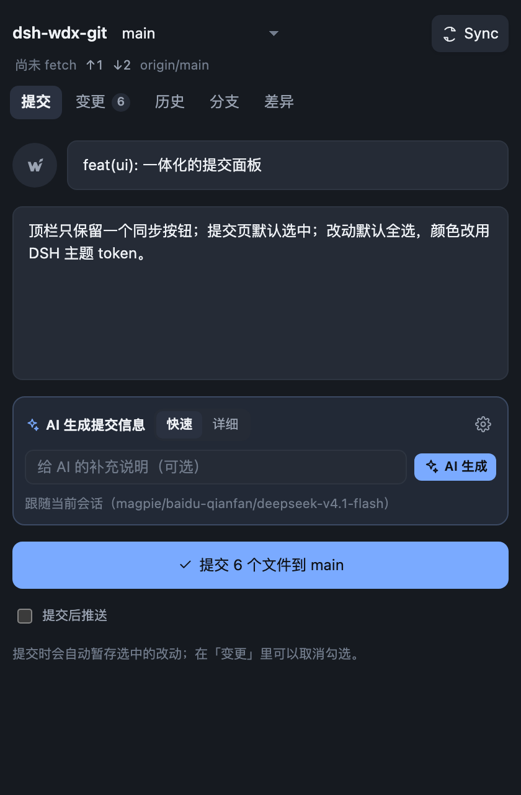
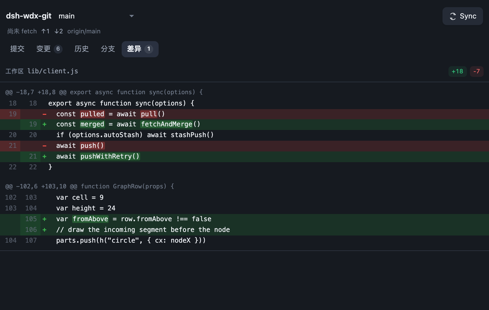
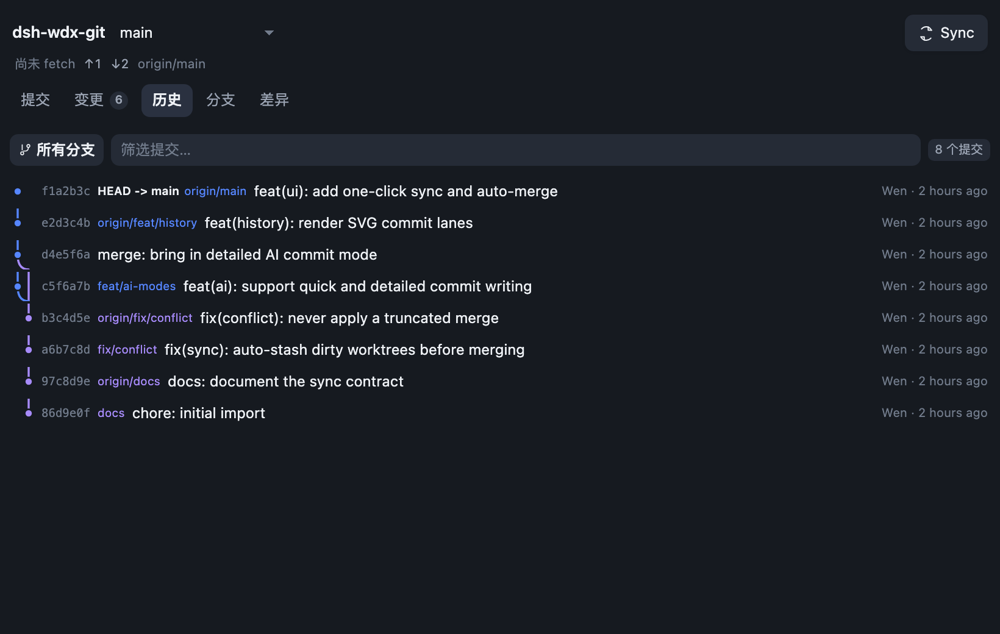
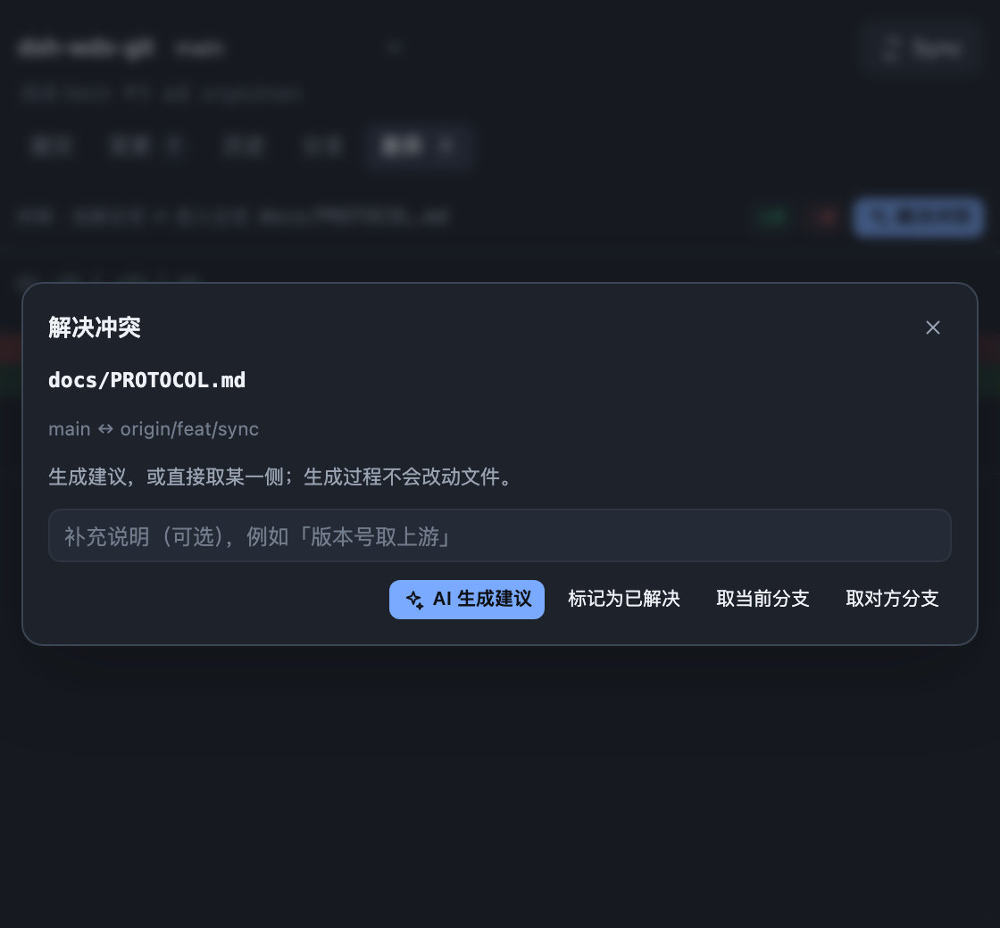

# WDX Git

WDX Git 在 DeepSeek Harness 右侧栏里加一个 Git 面板。从会话头部的分支图标，
或右栏 **+ → 开始 → WDX Git** 打开。提交、同步、历史、分支和冲突处理都留在
会话旁边，不用切到终端。

## 一个按钮完成同步

顶栏显示仓库、当前分支和一个同步按钮。按钮文字跟随仓库状态：

| 状态 | 按钮 |
| --- | --- |
| 没有要拉取或推送的内容 | Fetch origin |
| 落后远端 | Pull origin |
| 领先远端 | Push origin |
| 两边都有新提交 | Sync |
| 分支还没有 upstream | Publish branch |

落后或领先远端时，按钮内会显示带方向箭头的计数徽标：`↓` 是待拉取的远端提交，
`↑` 是待推送的本地提交。

点下去会 fetch、需要时补 upstream、快进或合并，有内容时再推送。工作区改动
会在合并前自动 stash，合并后恢复。推送被拒时只 fetch + merge + 重试一次。
遇到冲突就停下来。WDX Git 不 force push、不自动 rebase，也不改写已有历史。

## 跨项目仓库

左侧栏的 **Git** 入口打开全局仓库页。它自动列出当前 DSH 的所有工作区，左侧按父目录
分组，显示分支、ahead / behind 和改动数；右侧是该仓库的提交页。没有进入项目、
没有打开会话，也可以直接勾选文件、写提交信息、同步和查看历史。

概览每 30 秒刷新一次，也可以点右上角手动刷新。手动刷新时按钮至少旋转 650ms，完成后
短暂变成绿色对勾；仓库栏的状态行会显示正在刷新、更新了几个仓库、已是最新或失败原因，
有变化的仓库行会高亮 1.5 秒。全局页没有会话时，AI 提交信息使用
默认模型；如果本机工作区不是 Git 仓库，它仍会列出来并标注「非 Git 仓库」。

## 提交页

打开面板先进入提交页。Summary 和 Description 是独立输入框，改动默认全选。
取消勾选的文件留在工作区，只有勾选路径会被暂存并提交。

## AI 提交信息

一次生成标题和正文：标题写成具体的 Conventional Commit，正文按 PR 摘要的密度写——
一句动机，再 2–4 条具体改动；涉及测试时补一条覆盖范围。格式不合格（输出被截断、
标题是半句话、改动不小却正文过短或只有一句话）会自动带上上次被拒的原因重试，
最多 3 次；仍不行时保留可提交的降级文案。默认使用当前会话的模型，也可以在设置里
换模型和思考等级。请求包含本次提交的 diff、文件列表、最近的提交标题和选中的
未跟踪文本文件。取消勾选的文件不会出现在提交信息里。

## 变更、差异、历史与分支

变更页列出修改、新增和删除的文件，并为选中文件打开词级 diff。历史页显示
提交的父提交、作者、时间和信息，用 SVG 画出提交车道。分支页列出本地和远端
分支，可以切换或新建。Stash 用来暂存和恢复手头的工作。

## 冲突

fetch、merge、rebase、cherry-pick 或 revert 因冲突停下时，冲突页会显示
ours 和 theirs。可以取某一侧，让 AI 生成合并建议（只预览，确认后才写入），
或点「AI 解决全部」：插件逐个文件生成合并结果并直接写入、暂存，大文件按冲突块
分别处理，单个文件失败不会中断其余文件，最后汇总失败原因。设置里可以打开
「冲突后自动用 AI 解决」（默认关闭）：打开后，同步或拉取一旦产生冲突就直接开始
逐个处理，不再询问。也可以手工改完后标记为已解决，或从面板继续 / 中止 merge、
rebase、cherry-pick、revert。

## 本地数据

Git 用你本机已有的凭据、在会话打开的那个仓库里运行。插件不保存 token，
不做遥测，也不读取 DSH 账户或 GitHub 头像。macOS 下会读取系统 HTTP/HTTPS
代理，Finder 启动的 DSH 也能 fetch / push；其他平台使用 `HTTPS_PROXY`、
`HTTP_PROXY`、`ALL_PROXY` 或 git 自己的 `http.proxy`。

## 刻意不做

- 不 force push，不自动 rebase，不改写历史。
- 不做 commit signing。
- 暂存到文件级，不做 hunk 级或行级。
- 多远端时优先 `origin`。
- 不在后台自动提交。

## 安装

在 DSH 打开 **插件 → 添加插件**，输入 `dsh-wdx-git`，安装源选 npm，然后启用。
从源码安装则运行 `dsh plugin --profile <name> add ./dsh-wdx-git`。